# Workflow: Milan PO Approval (Purchase Order)

Machine-readable version: [`workflow-purchase-order.json`](workflow-purchase-order.json).

```mermaid
stateDiagram-v2
    [*] --> Draft
    Draft --> PendingFinanceReview: Submit for Review (Dept Head; ≤ ₹50k or 3 quotes ticked)
    PendingFinanceReview --> Approved: Approve (Finance Head; ≤ ₹1,00,000)
    PendingFinanceReview --> PendingFacultyApproval: Escalate (Finance Head; > ₹1,00,000)
    PendingFinanceReview --> Rejected: Reject
    PendingFacultyApproval --> Approved: Approve (Faculty Advisor)
    PendingFacultyApproval --> Rejected: Reject
    Rejected --> Draft: Revise (Dept Head)
    Approved --> Cancelled: Cancel (Finance Head)
    Approved --> [*]
```

## States

| State | Doc status | Who can edit |
|---|---|---|
| Draft | 0 (Draft) | Milan Dept Head |
| Pending Finance Review | 0 | Milan Finance Head |
| Pending Faculty Approval | 0 | Milan Faculty Advisor |
| Approved | 1 (Submitted) | Milan Finance Head |
| Rejected | 0 | Milan Dept Head |
| Cancelled | 2 (Cancelled) | Milan Finance Head |

## Transitions

| From | Action | To | Allowed role | Self-approval | Condition |
|---|---|---|---|---|---|
| Draft | Submit for Review | Pending Finance Review | Milan Dept Head | Yes | `doc.grand_total <= 50000 or doc.custom_quotes_compared` |
| Pending Finance Review | Approve | Approved | Milan Finance Head | No | `doc.grand_total <= 100000` |
| Pending Finance Review | Escalate | Pending Faculty Approval | Milan Finance Head | No | `doc.grand_total > 100000` |
| Pending Finance Review | Reject | Rejected | Milan Finance Head | No | — |
| Pending Faculty Approval | Approve | Approved | Milan Faculty Advisor | No | — |
| Pending Faculty Approval | Reject | Rejected | Milan Faculty Advisor | No | — |
| Rejected | Revise | Draft | Milan Dept Head | Yes | — |
| Approved | Cancel | Cancelled | Milan Finance Head | No | — |

## Notes

- The budget check (Stop) runs when the PO is **submitted**, which happens on the transition into *Approved*. An over-budget PO therefore can't be approved; the Finance Head must reject it or the Coordinators must approve a Budget Revision first.
- Custom field names created through Customize Form get a `custom_` prefix in recent versions; if yours differs, update the condition.
- Thresholds (₹50,000 and ₹1,00,000) are BRD assumptions — confirm with the faculty-in-charge (decision D3).
