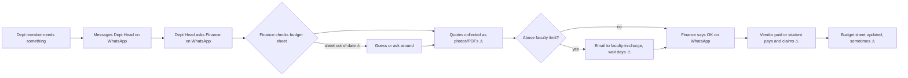
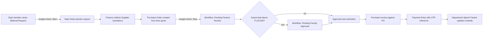
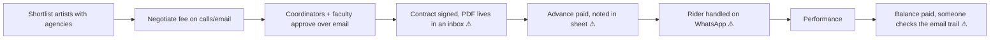
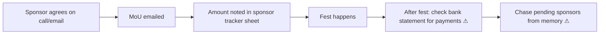
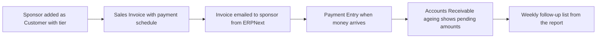
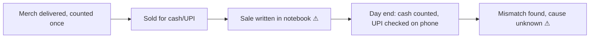
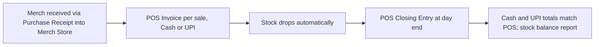
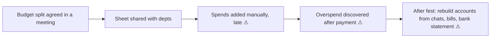
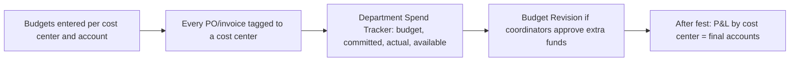

```mermaid
flowchart LR
    A[Agency added as Supplier] --> B[PO for Artist Performance Fee, Pronites cost center]
    B --> C[PO approval workflow incl. faculty]
    C --> D[Contract record linked to PO: date, rider, signed copy]
    D --> E[Payment terms 50% advance / 50% on show day]
    E --> F[Advance Payment Entry against PO]
    F --> G[Performance]
    G --> H[Purchase Invoice + balance Payment Entry]
    H --> I[PO shows fully billed and paid]
```

# 04 · Process Maps (AS-IS and TO-BE)

AS-IS maps show how Milan 2025 actually ran, reconstructed from the implementer's experience as Head of Pronites; each is checked with a 2025 teammate (see `01-stakeholder-review.md`). Red-flag notes (⚠) mark where time or money was lost. TO-BE maps show the same process in ERPNext, with the doctype used at each step.

The diagrams are Mermaid and render on GitHub. To export as images, paste them into [mermaid.live](https://mermaid.live) or import into draw.io (Arrange → Insert → Advanced → Mermaid).

---

## P1 · Purchasing a service or item

### AS-IS (Milan 2025)

### TO-BE

---

## P2 · Booking an artist (Pronites)

### AS-IS (Milan 2025)

### TO-BE

---

## P3 · Sponsorship to cash

### AS-IS (Milan 2025)

### TO-BE

---

## P4 · Merchandise sales

### AS-IS (Milan 2025)

### TO-BE

---

## P5 · Budget monitoring and fest closing

### AS-IS (Milan 2025)

### TO-BE

